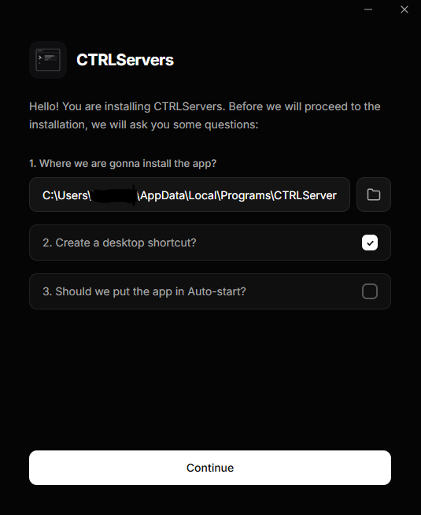

# CTRLServers Installer

Desktop installer for CTRLServers, built with Tauri 2, React, TypeScript and Tailwind CSS.



## Development

```bash
npm install
npm run tauri dev
```

## Build

```bash
npm run tauri build
```

The installer is written to `src-tauri/target/release/`.

what else we need to put here?
